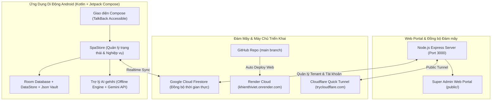

# 🏗️ KIẾN TRÚC DỰ ÁN VÀ CÔNG NGHỆ (TECHNICAL ARCHITECTURE)

Tài liệu này cung cấp toàn cảnh kiến trúc kỹ thuật của hệ thống **Khiếm Thị Việt**, bao gồm ứng dụng di động Android, cổng quản trị Web Portal, đám mây Firebase và trợ lý AI Gehihi.

---

## 1. Cấu Trúc Tổng Thể Hệ Thống

---

## 2. Chi Tiết Thành Phần Android App (`app/`)
- **Ngôn ngữ:** Kotlin 1.9+, Java 17.
- **Framework UI:** Jetpack Compose + Material3.
- **Màu sắc chủ đạo (`ui/theme/Color.kt`):**
  - `SpaRosewood` (`#6B4F4F`): Màu gỗ hoa ấm áp, thanh lịch.
  - `SpaRosewoodDark` (`#4E3838`): Nền tiêu đề và văn bản chính.
  - `SpaChampagne` (`#C49A6C`): Màu vàng Champagne cho nút nổi bật và tem Admin.
  - `SpaChampagneLight` (`#F3E7D8`): Nền badge nhẹ nhàng.
  - `SpaSageGreen` (`#7A8B7B`): Màu xanh xô thơm cho trạng thái "Đang làm" hoặc "Đã xong".
  - `SpaSageLight` (`#E6EFE7`): Nền thẻ trạng thái đang phục vụ.
  - `SpaDanger` (`#C95B5B`): Màu cam đỏ cho trạng thái "Chờ chốt" hoặc nút xóa.
  - `SpaCreamBg` (`#F9F6F2`): Nền ứng dụng màu kem dịu mắt.
- **Quản lý dữ liệu cục bộ:**
  - `SpaDatabase.kt` / `SpaEntities.kt`: Room Database lưu trữ hóa đơn, vé, danh mục dịch vụ.
  - `SpaStore.kt`: State holder trung tâm (~10.000 dòng mã) điều phối toàn bộ luồng nghiệp vụ.
  - `ImeInputHelper.kt`: Module chống dồn chữ, chống nhân bản ký tự cho bàn phím ảo LDPlayer/Android.
- **Trợ lý AI gehihi:**
  - Tích hợp mô hình Gemini API thông qua Google GenAI SDK.
  - Tích hợp On-device Query Engine offline (trả lời doanh thu, số khách, tra cứu KTV rảnh ngay cả khi mất mạng).

---

## 3. Hệ Thống Phân Quyền (RBAC - Role-Based Access Control)
Hệ thống chia làm các nhóm quyền rõ rệt:

| Vai Trò | Quyền Hạn Trong App | Quyền Dùng AI gehihi |
| :--- | :--- | :--- |
| **Chủ cơ sở (Root Owner/Admin)** | Toàn quyền cấu hình, tài chính, xóa vé, cấp quyền nhân viên | Có quyền (Toàn bộ tính năng) |
| **Nhân viên cấp ngang quyền Admin** | Quản lý vé, chốt tiền, xem báo cáo, sửa vé | Có quyền (Dùng đoạn chat riêng biệt) |
| **Kỹ thuật viên / Nhân viên thường** | Chỉ mở vé, hoàn thành giờ làm việc của vé mình phụ trách | **BỊ ẨN HOÀN TOÀN** (Không nhìn thấy nút AI) |

---

## 4. Hệ Thống Web Portal & Render
- **Thư mục Web:** `public/` (giao diện web quản lý cơ sở, xóa cơ sở, cấp tài khoản).
- **File máy chủ:** `server.js` (Express.js chạy trên cổng `3000`).
- **File khởi động:** `CHAY_WEB_PORTAL.bat`.
- **Render Live:** `https://khienthiviet.onrender.com/` (tự động cập nhật khi push commit mới lên GitHub `main`).
- **Cloudflare Tunnel:** `cloudflared.exe tunnel --url http://localhost:3000` cho phép tạo link public truy cập từ xa tức thời.
